# Fantasy Quest — Manual de usuario

Versión final 1.0 · 22 de noviembre de 2026

## Introducción

Fantasy Quest es un juego de preguntas narrativo: respondés 15 preguntas ambientadas en el mundo de Aeloria y el juego te dice qué serías en un mundo medieval de fantasía. El resultado es una raza (pura o mestiza) y una clase, por ejemplo un *Elfo mago*, un *Semiorco guerrero* o un *Rompemontaña herrero*.

- **Razas base:** orco, elfo, humano y enano.
- **Razas mestizas:** semiorco, semielfo, enano con gigantismo, elfo del yunque, elfo oscuro y rompemontaña.
- **Clases:** arquero, paladín, pícaro, guerrero, mago, granjero, esclavo, herrero, bufón, explorador, druida, hechicero y asesino.

Podés jugar con un jugador registrado, y así la partida se guarda y aparece en el scoreboard, o jugar anónimo sin registrarte.

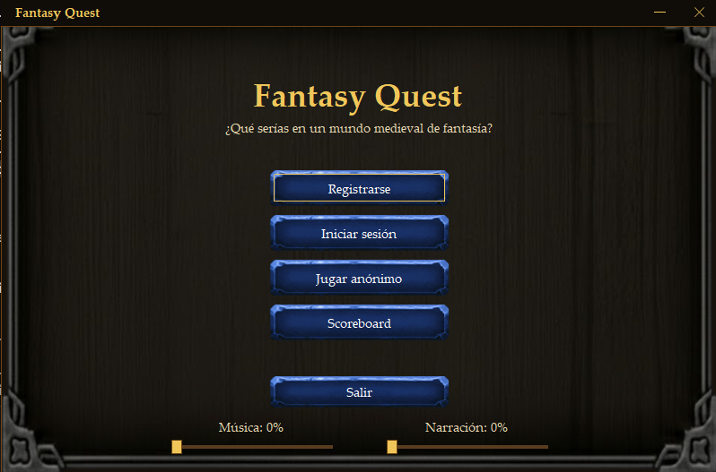
*Imagen 1 — Portada. Captura del menú principal recién abierto, con el título "Fantasy Quest" y el subtítulo "¿Qué serías en un mundo medieval de fantasía?" visibles.*

## Requisitos e instalación

Para jugar necesitás Windows 10 u 11 y el archivo `Fantasy_quest.exe`. Si querés guardar partidas y ver el scoreboard, también necesitás la base de datos MySQL del juego.

| Requisito | Para qué sirve |
| --- | --- |
| Windows 10 u 11 | Ejecutar el juego |
| .NET 9 Desktop Runtime | Lo necesita el ejecutable si no viene incluido |
| MySQL Server (o MariaDB) en `localhost:3306` con la base `fantasy_quest_bdd` | Registrarse, iniciar sesión, guardar partidas y ver el scoreboard |
| Parlantes o auriculares | Música de fondo, narración de cada capítulo y canción final |

1. Creá la base de datos ejecutando el script `Base_de_datos/fantasy_quest_bdd.sql` en MySQL.
2. Abrí `Fantasy_quest.exe`.
3. Si aparece el aviso "No hay conexión con la base de datos", podés seguir y jugar anónimo, pero la partida no se guarda.

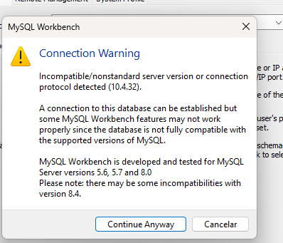
*Imagen 2 — Aviso sin conexión. Cartel "No hay conexión con la base de datos. Podés jugar anónimo, pero no se va a poder guardar la partida." sobre el menú principal. Se obtiene abriendo el juego con MySQL detenido.*

## La ventana del juego

El juego usa su propia barra de título en lugar de la de Windows. Todas las pantallas se abren en la misma ventana: cada pantalla nueva reemplaza a la anterior en el mismo lugar, y si movés la ventana, la siguiente aparece donde la dejaste.

| Elemento | Qué hace |
| --- | --- |
| Barra superior | Muestra el nombre de la ventana. Mantenela apretada con el clic izquierdo y arrastrá para mover la ventana |
| Botón — (minimizar) | Oculta la ventana en la barra de tareas. Para volver, hacé clic en el ícono del juego en la barra de tareas |
| Botón ✕ (cerrar) | Cierra el juego completo, estés en la pantalla que estés. Si estás en medio de una partida, primero te pregunta "¿Salir del juego?" |
| Botón ← Atrás | Vuelve a la pantalla anterior sin cerrar el juego |

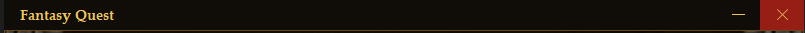
*Imagen 3 — Barra de título. Recorte de la parte superior de la ventana con el mouse sobre el botón ✕ (resaltado en rojo). Marcar con flechas o números la zona para arrastrar, el botón minimizar y el botón cerrar.*

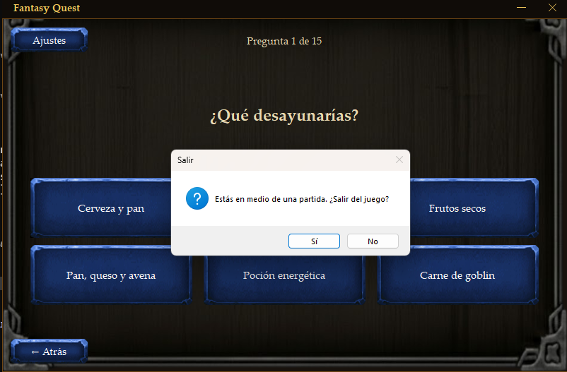
*Imagen 4 — Confirmación al cerrar. Cartel "Estás en medio de una partida. ¿Salir del juego?" con los botones Sí y No, sobre la pantalla de una pregunta.*

## Menú principal

El menú principal es la primera pantalla del juego y desde ahí se llega a todo lo demás.

| Botón | Qué hace |
| --- | --- |
| Registrarse | Crea un jugador nuevo y abre tu menú de jugador |
| Iniciar sesión | Entra con un jugador que ya registraste |
| Jugar anónimo | Empieza una partida sin jugador. No se guarda, salvo que te registres al terminar |
| Scoreboard | Muestra las partidas terminadas de todos los jugadores |
| Salir | Cierra el juego |

Abajo hay dos controles de volumen, de 0 a 100 %:

- **Música:** el volumen de la música de fondo y de la canción final.
- **Narración:** el volumen de la voz que lee cada capítulo.

Para cambiarlos, hacé clic o arrastrá sobre la barra. También podés usar la rueda del mouse, que mueve el volumen de a 5 %. Los mismos controles están en el menú **Ajustes** de las otras pantallas y siempre muestran el mismo valor.

*Imagen 5 — Menú principal. Captura completa con los cinco botones y las dos barras de volumen. Conviene que las barras no estén al 100 % (por ejemplo, Música 60 % y Narración 80 %) para que se note que se pueden mover.*

## Registrarse e iniciar sesión

Para registrarte o iniciar sesión hace falta tu nombre de jugador y una contraseña. Las dos opciones usan la misma pantalla.

**Registrarse**

1. En el menú principal, hacé clic en **Registrarse**.
2. Escribí un nombre en el campo **Nombre**. Debe tener entre 2 y 30 caracteres, con letras (se aceptan acentos y ñ), números y espacios simples. No se admiten símbolos, emojis ni dos espacios seguidos. Los espacios al principio y al final se ignoran.
3. Escribí una **Contraseña** de entre 4 y 30 caracteres. Se muestra con puntos mientras tipeás y distingue mayúsculas de minúsculas. La contraseña nunca se guarda en claro: la base guarda solo su hash SHA-256.
4. Hacé clic en **Registrarme**. Si el nombre ya está en uso, el juego te avisa y tenés que elegir otro. Si el nombre o la contraseña no cumplen el formato, aparece un cartel "Nombre inválido" o "Contraseña inválida" con el motivo.

**Iniciar sesión**

1. En el menú principal, hacé clic en **Iniciar sesión**.
2. Escribí el nombre con el que te registraste y tu contraseña.
3. Hacé clic en **Entrar**. Si el nombre no existe, aparece "No existe un jugador con ese nombre. Registrate primero." Si la contraseña no coincide, aparece "Contraseña incorrecta."

Si todo sale bien, se abre tu menú de jugador. Con **← Atrás** volvés al menú principal.

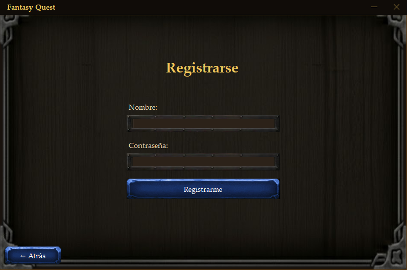
*Imagen 6 — Registrarse. Pantalla con el título "Registrarse", un nombre de ejemplo en el campo Nombre, la contraseña con puntos y el botón "Registrarme".*

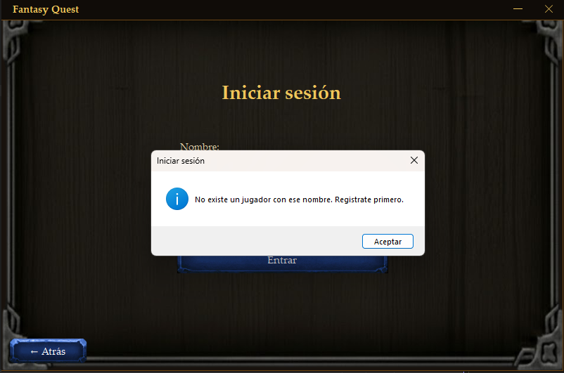
*Imagen 7 — Iniciar sesión con error. Pantalla "Iniciar sesión" con el cartel "No existe un jugador con ese nombre. Registrate primero." a la vista.*

## Menú del jugador

El menú del jugador te saluda por tu nombre y te deja empezar una partida nueva o seguir la que dejaste sin terminar. Podés tener una sola partida pendiente a la vez.

| Situación | Qué se ve | Qué podés hacer |
| --- | --- | --- |
| No tenés partidas pendientes | Botón **Iniciar** | Empezar una partida nueva |
| Tenés una partida sin terminar | Mensaje "Tenés una partida sin terminar.", botón **Continuar** y botón **Abandonar partida pendiente** | Seguir desde la pregunta donde quedaste, o abandonarla |

Cuando abandonás una partida, el juego te pide confirmación porque se pierde el progreso. Después vuelve a aparecer el botón **Iniciar**.

**← Atrás** cierra tu sesión y te devuelve al menú principal. Tus respuestas quedan guardadas al instante, así que podés salir en cualquier momento y seguir otro día.

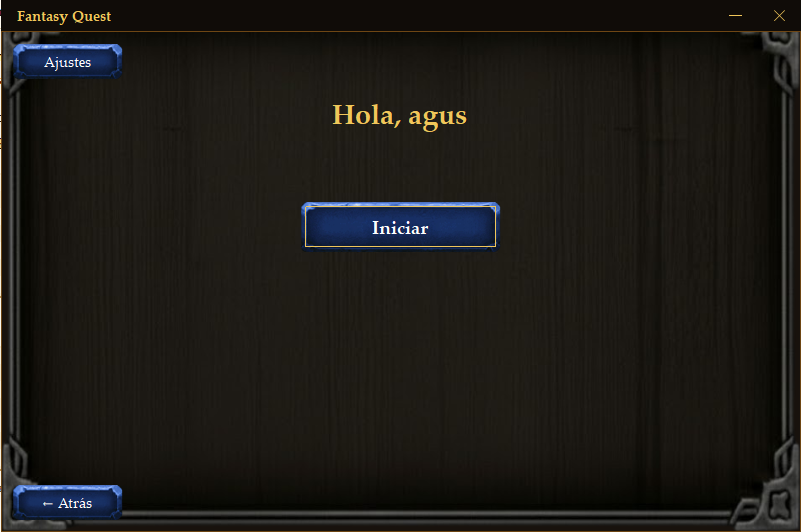
*Imagen 8 — Menú del jugador sin partida. Saludo "Hola, \<nombre\>", el botón "Ajustes" arriba a la izquierda y solo el botón "Iniciar".*

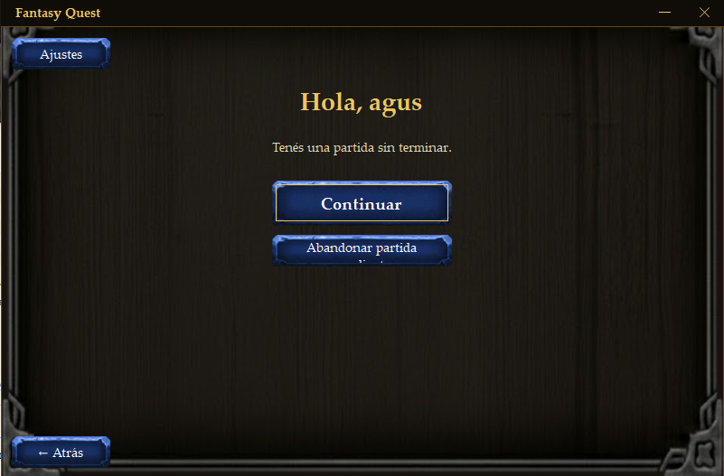
*Imagen 9 — Menú del jugador con partida pendiente. Saludo, mensaje "Tenés una partida sin terminar." y los botones "Continuar" y "Abandonar partida pendiente". Se obtiene empezando una partida, respondiendo un par de preguntas y volviendo con Atrás.*

## Menú Ajustes

En el menú del jugador, en la introducción de cada capítulo y en cada pregunta hay un botón **Ajustes** arriba a la izquierda. Al hacer clic se despliega un panel; otro clic en **Ajustes** lo cierra.

| Control | Qué hace |
| --- | --- |
| Música | Volumen de la música de fondo (igual que en el menú principal) |
| Narración | Volumen de la voz del narrador |
| Volver al menú principal | Cierra todas las pantallas abiertas y vuelve al menú principal. Si estabas logueado, se cierra la sesión |

Si usás **Volver al menú principal** en medio de una partida registrada, lo respondido queda guardado y la podés continuar después. En una partida anónima, el juego te pide confirmación porque el progreso se pierde.

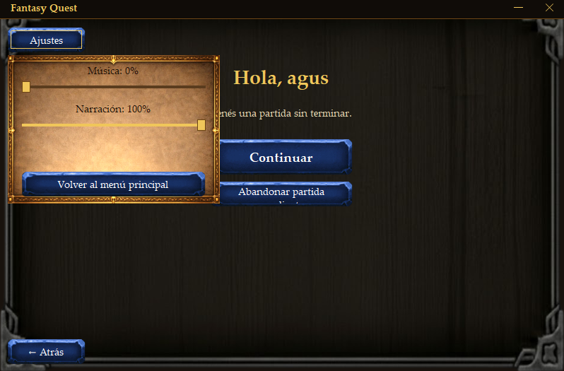
*Imagen 10 — Menú Ajustes. Panel desplegado sobre una pregunta, con las barras Música y Narración y el botón "Volver al menú principal".*

## Jugar una partida

Una partida tiene 15 capítulos. Cada capítulo empieza con una introducción narrada y termina con una pregunta que respondés eligiendo una opción.

1. **Introducción del capítulo.** Arriba aparecen "Capítulo N de 15" y el título, y debajo la historia en un pergamino mientras una voz la lee.
   - Si el texto no entra, usá la barra dorada de la derecha o la rueda del mouse para leer el resto.
   - **Silenciar** apaga solo la narración (la música sigue) y queda así para los próximos capítulos. **Activar sonido** la vuelve a prender por donde iba.
   - **Continuar →** corta la narración y pasa a la pregunta.
2. **Pregunta.** Arriba dice "Pregunta N de 15" y debajo aparecen 6 respuestas como botones. Hacé clic en la que elijas. No hay respuestas correctas ni incorrectas: cada una suma puntos a ciertas razas y clases. Una vez elegida, la respuesta no se puede cambiar.
3. Después de responder se abre la introducción del capítulo siguiente. Esto se repite hasta la pregunta 15.
4. Al responder la última, el juego muestra "Calculando resultado..." y después abre la pantalla de resultado con la canción final.

**Si jugás anónimo:** al terminar, el juego te pregunta "¿Querés registrarte para guardarla?". Si respondés Sí, se abre la pantalla de registro y, al registrarte, aparece "Partida guardada a nombre de \<nombre\>".

**Salir a mitad de partida:**

| Tipo de partida | ← Atrás o Ajustes → Volver al menú | ✕ (cerrar) |
| --- | --- | --- |
| Con jugador registrado | Sale sin preguntar. La partida queda pendiente y la podés **Continuar** después | Pregunta si querés salir. Lo respondido queda guardado |
| Anónima | Avisa "si salís se pierde el progreso" y pide confirmación (salvo que todavía no hayas respondido ninguna) | Pregunta si querés salir. El progreso se pierde |

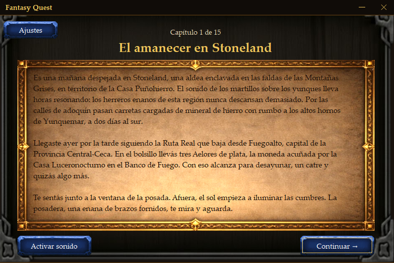
*Imagen 11 — Introducción de un capítulo. "Capítulo 1 de 15", el título, el texto en el pergamino, la barra de desplazamiento dorada (si el texto es largo) y los botones "Ajustes", "Silenciar" y "Continuar →".*

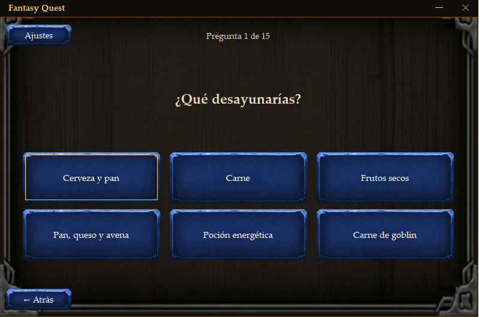
*Imagen 12 — Pregunta. "Pregunta 1 de 15", el texto de la pregunta y la grilla de 6 botones de respuesta, con el mouse sobre uno para que se vea resaltado.*

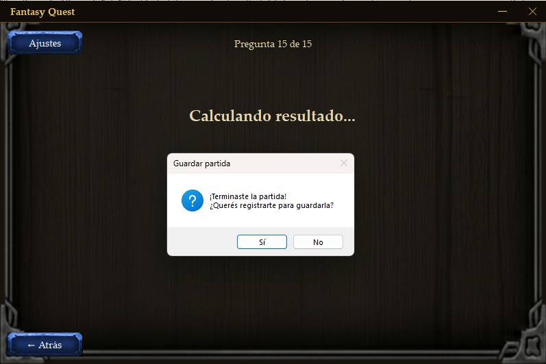
*Imagen 13 — Guardar partida anónima. Cartel "¡Terminaste la partida! ¿Querés registrarte para guardarla?" al terminar una partida anónima.*

## Resultado y puntajes

Al terminar la partida, la pantalla de resultado muestra qué serías en el mundo de Aeloria: tu raza (en grande), tu raza principal, tu raza secundaria y tu clase, junto a un avatar con el marco de tu raza principal y el ícono de tu clase.

**¿Pura o mestiza?** La raza con más puntos es la principal y la segunda es la secundaria. Si la secundaria llega al menos a un tercio (33 %) del total de puntos de raza, el resultado es una raza **mestiza**; si no, sos de raza **pura**.

| Mezcla | Raza mestiza |
| --- | --- |
| Humano + orco | Semiorco |
| Humano + elfo | Semielfo |
| Humano + enano | Enano con gigantismo |
| Elfo + enano | Elfo del yunque |
| Elfo + orco | Elfo oscuro |
| Enano + orco | Rompemontaña |

| Botón | Qué hace |
| --- | --- |
| Ver puntajes | Abre el detalle de puntos de cada raza y cada clase |
| Volver a jugar | Vuelve al menú principal. Si habías iniciado sesión, la sesión se cierra |
| ← Atrás | Vuelve a la pantalla desde donde empezaste la partida (el menú del jugador o el menú principal) |

La pantalla **Puntajes** tiene dos tablas: a la izquierda los puntos de cada raza y a la derecha los de cada clase, ordenados de mayor a menor. Sirven para ver por qué te tocó ese resultado.

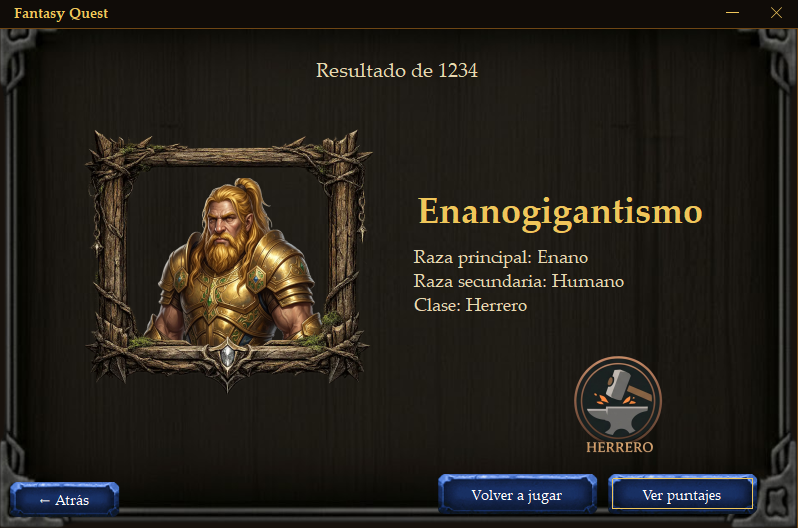
*Imagen 14 — Resultado mestizo. Pantalla de resultado al final de una partida con una raza mestiza (por ejemplo Semielfo): avatar con marco a la izquierda, ícono de clase, la raza en grande, el detalle de raza principal, secundaria y clase, y los botones "Volver a jugar", "Ver puntajes" y "← Atrás".*

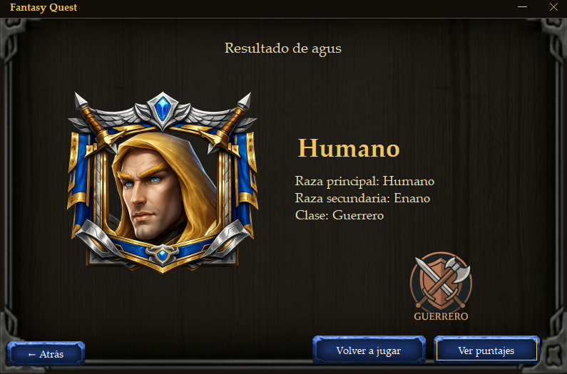
*Imagen 15 — Resultado puro. Misma pantalla con una raza pura (por ejemplo Orco), para comparar el avatar con el de la imagen anterior.*

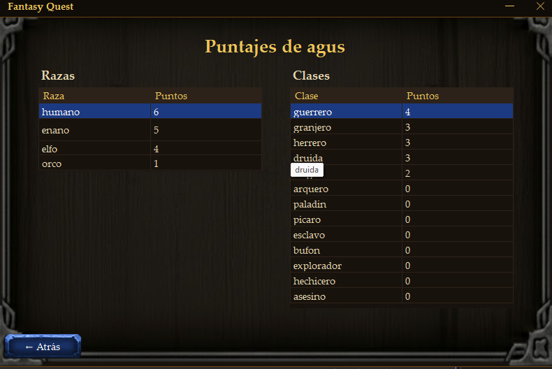
*Imagen 16 — Puntajes. Pantalla Puntajes con las dos tablas (Razas y Clases) completas, ordenadas de mayor a menor.*

## Scoreboard

El scoreboard muestra las partidas terminadas de todos los jugadores registrados, de la más reciente a la más antigua, con jugador, resultado, clase y fecha. Para verlo hace falta conexión con la base de datos.

**Para ver el resultado de una partida:**

1. En el menú principal, hacé clic en **Scoreboard**.
2. Elegí una partida de la lista.
3. Hacé clic en **Ver resultado**, o doble clic sobre la fila. Si no elegiste ninguna, aparece "Elegí una partida de la lista."

Desde el resultado de una partida del scoreboard también podés abrir **Ver puntajes**. **← Atrás** te devuelve a la lista.

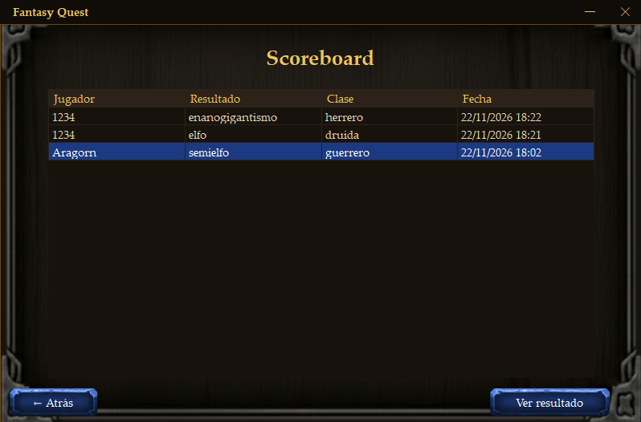
*Imagen 17 — Scoreboard. Lista con varias partidas cargadas y una fila seleccionada (resaltada en azul), con los botones "Ver resultado" y "← Atrás".*

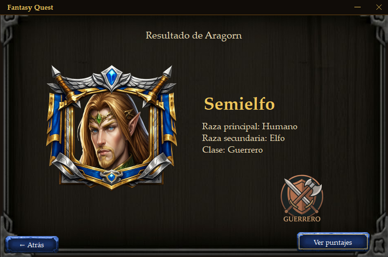
*Imagen 18 — Resultado de otro jugador. Resultado abierto desde el scoreboard, con el título "Resultado de \<nombre\>". En esta pantalla no aparece el botón "Volver a jugar".*

## Preguntas frecuentes y solución de problemas

| Problema o pregunta | Qué hacer |
| --- | --- |
| Aparece "No hay conexión con la base de datos" | Verificá que MySQL esté encendido en `localhost:3306` y que exista la base `fantasy_quest_bdd`. Mientras tanto podés jugar anónimo |
| "No existe un jugador con ese nombre" | Revisá cómo escribiste el nombre, o registrate primero |
| "Contraseña incorrecta" | Revisá la contraseña: distingue mayúsculas y minúsculas. Si no la recordás, pedile a un administrador que borre tu jugador para volver a registrarte |
| No puedo iniciar una partida nueva | Ya tenés una pendiente. Usá **Continuar** o **Abandonar partida pendiente** en tu menú de jugador |
| "La partida pendiente no coincide con las preguntas actuales" | La partida se guardó con una versión anterior del juego. Abandonala y empezá una nueva |
| Me equivoqué de respuesta | En esta versión no se puede volver atrás una respuesta. Si es una partida registrada, podés abandonarla y empezar de nuevo |
| ¿Puedo pausar la música o la narración? | No hay pausa: podés bajar el volumen a 0 % desde el menú principal o **Ajustes**, o usar **Silenciar** en la introducción |
| No escucho la narración | Revisá que no esté en **Silenciar** dentro de la introducción y que la barra **Narración** no esté en 0 % |
| La música está muy fuerte | Bajá la barra **Música** en el menú principal o en **Ajustes** |
| ¿Se pierde mi partida si cierro el juego? | Si iniciaste sesión, no: las respuestas se guardan al instante y la podés continuar después. Si jugás anónimo, sí |
| Minimicé el juego y no lo encuentro | Hacé clic en el ícono de Fantasy Quest en la barra de tareas de Windows |
| ¿Cómo muevo la ventana? | Arrastrala desde la barra superior oscura, donde está el título |
