# DER v2 — Programa Fantasy Quest

Diagrama de entidades y relaciones de todo el programa C# (`CShard_algoritmo/Fantasy_quest`), hecho con [Mermaid](https://mermaid.js.org/) como diagrama de clases: cada entidad es una clase o enum del código, con sus datos y operaciones principales. GitHub lo dibuja directamente; para exportarlo como imagen se puede pegar el bloque en https://mermaid.live. El diagrama de la base de datos está en `Documentacion/diagrama base de datos/DER v2.md`.

```mermaid
classDiagram
    direction LR

    namespace Formularios {
        class FrmPrincipal
        class FrmIngreso
        class FrmMenuJugador
        class FrmIntroduccion
        class FrmPartida
        class FrmResultado
        class FrmPuntajes
        class FrmScoreboard
        class Navegador {
            <<static>>
            +Abrir(actual, siguiente, volver) DialogResult
            +Volver(actual)
            +Jugar(actual, gestor)
        }
    }

    namespace Gestoras {
        class GestorPartida {
            -List~int~ respuestas
            +Jugador? Jugador
            +int? IdPartida
            +List~Pregunta~ Preguntas
            +Perfil Perfil
            +ResultadoPartida? Resultado
            +bool EsAnonima
            +int IndiceActual
            +bool Terminada
            +Pregunta PreguntaActual
            +NuevaAnonima(repositorio)$ GestorPartida
            +Nueva(jugador, repositorio)$ GestorPartida
            +Reanudar(jugador, idPartida, repositorio)$ GestorPartida
            +Responder(nroRespuesta)
            +Finalizar() ResultadoPartida
            +GuardarEn(jugador)
        }
        class sql_repository {
            +RegistrarJugadorNuevo(nombre) Jugador
            +IniciarSesion(nombre) Jugador?
            +RegistrarPartida(idJugador, modo) int
            +GuardarRespuesta(idPartida, nroPregunta, nroRespuesta)
            +GuardarPuntajes(idPartida, puntosRaza, puntosClase)
            +FinalizarPartida(idPartida, principal, secundaria, combinacion, clase)
            +CancelarPartida(idPartida, motivo)
            +ObtenerPartidaPendiente(idJugador) int?
            +ObtenerRespuestas(idPartida) List~int~
            +ObtenerResultado(idPartida) ResultadoPartida
            +ObtenerScoreboard() DataTable
        }
        class DAO_gestora {
            -string cadenaConexion
            +CrearConexion() MySqlConnection
            +ProbarConexion() bool
            +EjecutarConsulta(sql, parametros) DataTable
            +EjecutarProcedimiento(nombre, parametros)
            +EjecutarProcedimientoConSalida(nombre, parametros, salida) int
        }
    }

    namespace Dominio {
        class Jugador {
            +int Id
            +string Nombre
        }
        class BancoPreguntas {
            <<static>>
            +Crear()$ List~Pregunta~
        }
        class Pregunta {
            +string Titulo
            +string Historia
            +string Texto
            +List~Respuesta~ Respuestas
        }
        class Respuesta {
            +string Texto
            +Dictionary PuntosRaza
            +Dictionary PuntosClase
            +Suma(raza, puntos) Respuesta
            +Suma(clase, puntos) Respuesta
        }
        class Perfil {
            +Dictionary PuntosRaza
            +Dictionary PuntosClase
            +Aplicar(respuesta)
            +CalcularResultado(nombreJugador) ResultadoPartida
        }
        class ResultadoPartida {
            +string? NombreJugador
            +razas RazaPrincipal
            +razas RazaSecundaria
            +CombinacionRaza Combinacion
            +clase Clase
            +Dictionary PuntosRaza
            +Dictionary PuntosClase
            +ObtenerCombinacion(a, b)$ CombinacionRaza
        }
    }

    namespace enums {
        class razas {
            <<enumeration>>
            orco
            elfo
            humano
            enano
        }
        class clase {
            <<enumeration>>
            arquero
            paladin
            picaro
            guerrero
            mago
            granjero
            esclavo
            herrero
            bufon
            explorador
            druida
            hechicero
            asesino
        }
        class CombinacionRaza {
            <<enumeration>>
            semiorco
            semielfo
            enanogigantismo
            ElfoYunqu
            ElfoOscuro
            RompeMontaña
        }
        class modo_juego {
            <<enumeration>>
            clasico
            narrativo
        }
    }

    namespace ui {
        class Tema {
            <<static>>
            +Aplicar(formulario)
        }
        class BarraTitulo
        class Sonido {
            <<static>>
            +Pista Musica
            +Pista Narracion
            +NarrarCapitulo(numero)
            +TocarMusicaFondo()
        }
        class Pista {
            +int Volumen
            +bool Silenciado
            +Reproducir(nombre, repetir)
            +Detener()
        }
    }

    %% navegacion entre ventanas
    FrmPrincipal ..> FrmIngreso : abre
    FrmPrincipal ..> FrmMenuJugador : abre
    FrmPrincipal ..> FrmScoreboard : abre
    FrmMenuJugador ..> Navegador : Jugar
    FrmPrincipal ..> Navegador : Jugar anonimo
    Navegador ..> FrmPartida : abre
    Navegador ..> FrmResultado : abre
    FrmPartida ..> FrmIntroduccion : antes de cada pregunta
    FrmResultado ..> FrmPuntajes : abre
    FrmScoreboard ..> FrmResultado : Ver resultado

    %% formularios y logica
    FrmPartida --> GestorPartida : usa
    FrmMenuJugador --> Jugador : sesion
    FrmIngreso ..> sql_repository : registro / login
    FrmScoreboard ..> sql_repository : scoreboard
    FrmResultado --> ResultadoPartida : muestra
    FrmPuntajes --> ResultadoPartida : muestra
    FrmIntroduccion --> Pregunta : muestra historia

    %% gestoras
    GestorPartida --> sql_repository : guarda progreso
    sql_repository --> DAO_gestora : ejecuta SQL
    GestorPartida "0..1" --> "1" Jugador : null si es anonima
    GestorPartida *-- "1" Perfil : acumula puntos
    GestorPartida o-- "15" Pregunta : preguntas
    GestorPartida ..> BancoPreguntas : Crear()
    GestorPartida --> "0..1" ResultadoPartida : al finalizar
    GestorPartida ..> modo_juego

    %% dominio
    BancoPreguntas ..> Pregunta : crea
    Pregunta *-- "1..6" Respuesta : opciones
    Perfil ..> Respuesta : Aplicar
    Perfil ..> ResultadoPartida : CalcularResultado
    Respuesta ..> razas : suma puntos
    Respuesta ..> clase : suma puntos
    ResultadoPartida --> razas : principal y secundaria
    ResultadoPartida --> CombinacionRaza
    ResultadoPartida --> clase

    %% interfaz
    Tema ..> BarraTitulo : agrega a cada ventana
    Sonido *-- "2" Pista : musica y narracion
```

## Cómo leer el diagrama

| Flecha | Significado | Ejemplo |
| --- | --- | --- |
| `*--` composición | La parte vive y muere con el todo | Cada `Pregunta` tiene de 1 a 6 `Respuesta` |
| `o--` agregación | El todo usa una colección que se crea aparte | `GestorPartida` recibe las 15 `Pregunta` de `BancoPreguntas` |
| `-->` asociación | Una clase guarda una referencia a la otra | `GestorPartida` guarda el `Jugador` (null si la partida es anónima) |
| `..>` dependencia | Una clase usa o abre a la otra sin guardarla | `FrmResultado` abre `FrmPuntajes` |

## Flujo de una partida

1. `GestorPartida` se crea con `Nueva`, `NuevaAnonima` o `Reanudar` y carga las 15 preguntas de `BancoPreguntas`.
2. Cada `Responder(n)` le pasa la `Respuesta` elegida al `Perfil`, que suma sus puntos de `razas` y `clase`. Si la partida es de un jugador registrado, `sql_repository` guarda la respuesta en la base.
3. `Finalizar()` le pide a `Perfil` el `ResultadoPartida`: raza principal y secundaria (las dos con más puntos), su `CombinacionRaza` y la `clase` con más puntos. Si la partida no es anónima, se guarda en la base.
4. Si la partida fue anónima y el jugador se registra al final, `GuardarEn(jugador)` vuelca todo a la base.
