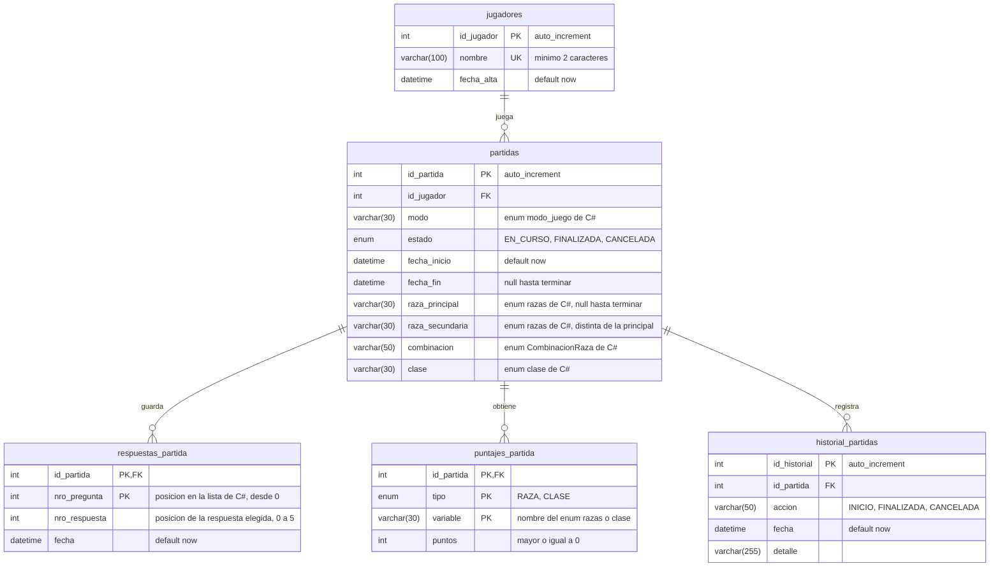

# DER v2 — fantasy_quest_bdd

Diagrama entidad-relación de la versión 2 de la base (`Base_de_datos/fantasy_quest_bdd.sql`), hecho con [Mermaid](https://mermaid.js.org/). GitHub y VS Code (con la extensión de vista previa de Markdown + Mermaid) lo dibujan directamente; para exportarlo como imagen se puede pegar el bloque en https://mermaid.live.

## Reglas que no se ven en el diagrama

- **Una sola partida `EN_CURSO` por jugador**: lo controla `sp_registrar_partida` (índice `idx_partida_jugador_estado` sobre `id_jugador, estado`).
- **Partida `FINALIZADA` con resultado completo**: `chk_resultado` exige `raza_principal`, `raza_secundaria`, `combinacion` y `clase` no nulos.
- **Fechas**: `chk_fechas` exige `fecha_fin >= fecha_inicio`.
- **Respuestas en orden**: `sp_guardar_respuesta` solo acepta la pregunta siguiente a la última guardada.
- **Sin tablas de catálogo**: razas, clases, combinaciones y modos de juego viven en los enums de C# y se guardan como texto (`Enum.ToString()` / `Enum.Parse()`). En la v1 eran tablas propias (`razas`, `clases`, `combinaciones_raza`, `modos_juego`, `estados_partida`).

## Vistas y procedimientos

| Objeto | Tipo | Usa |
| --- | --- | --- |
| `vw_partidas_pendientes` | vista | `partidas`, `jugadores`, `respuestas_partida` |
| `vw_historial` | vista | `partidas`, `jugadores` |
| `fn_partida_pendiente` | función | `partidas` |
| `sp_registrar_jugador`, `sp_modificar_jugador` | procedimientos | `jugadores` |
| `sp_registrar_partida`, `sp_finalizar_partida`, `sp_cancelar_partida` | procedimientos | `partidas`, `historial_partidas` |
| `sp_guardar_respuesta` | procedimiento | `respuestas_partida` |
| `sp_guardar_puntaje` | procedimiento | `puntajes_partida` |
