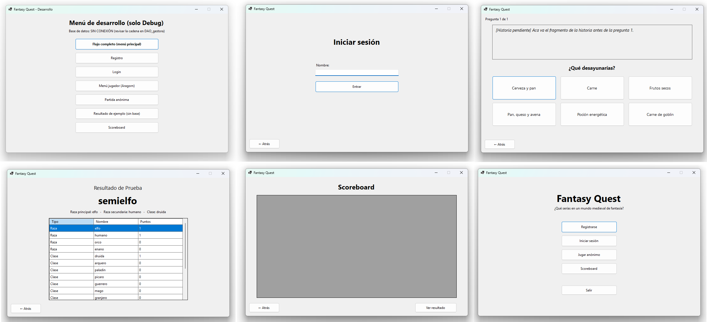
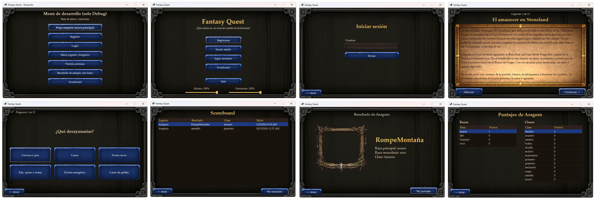
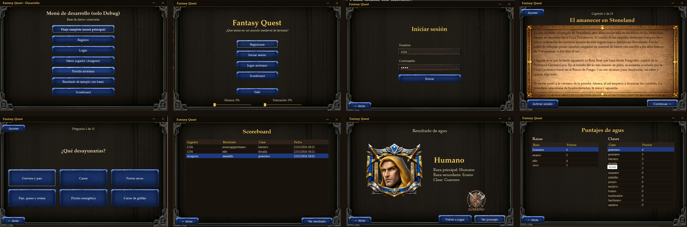
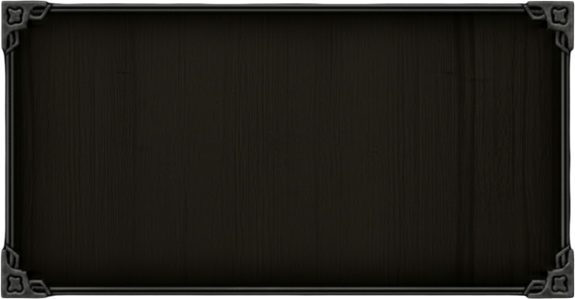
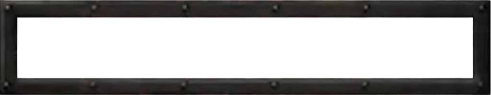
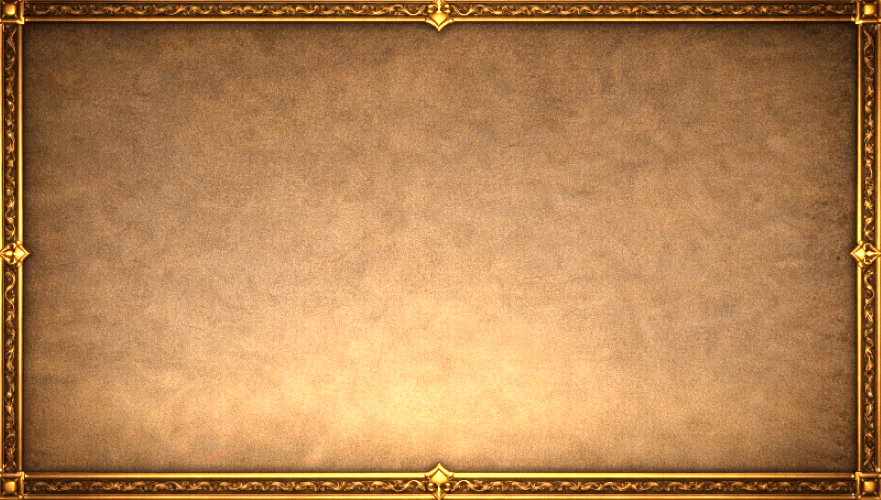

# Proyecto Algoritmos — Fantasy Quest

Juego de preguntas narrativo ambientado en el mundo de **Aeloria**. El jugador responde 15 preguntas y, según sus respuestas, se le asigna un **perfil** combinando raza (pura o mestiza) y clase: *Elfo mago*, *Semiorco guerrero*, *Rompemontaña herrero*, etc.

Versión final 1.0 · 22 de noviembre de 2026

---

## Indice

1. [Resumen](#resumen)
2. [Tecnologias](#tecnologias)
3. [Instalacion rapida](#instalacion-rapida)
4. [Estructura del repositorio](#estructura-del-repositorio)
5. [Arquitectura](#arquitectura)
6. [Documentacion](#documentacion)
   - [Documentos principales](#documentos-principales)
   - [Narrativa y diseno](#narrativa-y-diseno)
   - [Seguimiento](#seguimiento)
7. [Diagramas](#diagramas)
   - [Base de datos](#base-de-datos-diagramas)
   - [Algoritmos / clases](#algoritmos--clases)
8. [Interfaz](#interfaz)
   - [Historial de diseno](#historial-de-diseno)
   - [Recursos visuales actuales](#recursos-visuales-actuales)
9. [Recursos multimedia](#recursos-multimedia)
   - [Arte de razas](#arte-de-razas)
   - [Narraciones y banda sonora](#narraciones-y-banda-sonora)
10. [Base de datos](#base-de-datos)
11. [Referencias externas](#referencias-externas)

---

## Resumen

- **Razas base:** orco, elfo, humano y enano.
- **Razas mestizas:** semiorco, semielfo, enano con gigantismo, elfo del yunque, elfo oscuro y rompemontaña.
- **Clases:** arquero, paladín, pícaro, guerrero, mago, granjero, esclavo, herrero, bufón, explorador, druida, hechicero y asesino.
- **Modos:** partida registrada (se guarda y entra al scoreboard) o partida anónima.
- **Extras:** narración por capítulo, música de fondo con control de volumen, canción final.

[↑ Volver al indice](#indice)

---

## Tecnologias

- **C# / Windows Forms** (.NET 9.0)
- **MySQL / MariaDB** como motor de base de datos
- **MySql.Data** (NuGet) para la conexion
- Visual Studio 2022 / 2026, MSBuild
- MySQL Workbench para la BDD

[↑ Volver al indice](#indice)

---

## Instalacion rapida

Requisitos mínimos (detalle completo en el [Manual de usuario](Documentacion/Manual%20de%20usuario.md)):

| Requisito | Para que sirve |
| --- | --- |
| Windows 10 u 11 | Ejecutar el juego |
| .NET 9 Desktop Runtime | Correr `Fantasy_quest.exe` si no viene incluido |
| MySQL / MariaDB en `localhost:3306` con la base `fantasy_quest_bdd` | Registrarse, iniciar sesion, guardar partidas y ver el scoreboard |
| Parlantes o auriculares | Musica, narracion por capitulo y cancion final |

Pasos:

1. Correr `Base_de_datos/fantasy_quest_bdd.sql` contra una instancia MySQL vacía.
2. Abrir la solucion `CShard_algoritmo/Fantasy_quest.sln` en Visual Studio 2022+ y compilar.
3. Ejecutar `Fantasy_quest.exe` (en Release se oculta la pantalla de desarrollo).

[↑ Volver al indice](#indice)

---

## Estructura del repositorio

```
Proyecto-Algoritmos/
├── CShard_algoritmo/              # Solucion y proyecto C#
│   └── Fantasy_quest/
│       ├── Dominio/               # Entidades: Jugador, Perfil, Pregunta, Respuesta, BancoPreguntas, ResultadoPartida
│       ├── Formularios/           # Ventanas WinForms (Principal, Ingreso, MenuJugador, Introduccion,
│       │                          #                   Partida, Resultado, Scoreboard, Puntajes, Desarrollo)
│       ├── Gestoras/              # Orquestacion y acceso a datos (GestorPartida, sql_repository)
│       ├── enums/                 # Enumerados (razas, clases, modo_juego)
│       ├── ui/                    # Tema visual, componentes (BarraTitulo, MenuSettings, Sonido...), imagenes y licencia
│       └── Program.cs
├── Base_de_datos/
│   └── fantasy_quest_bdd.sql      # Script completo de creacion de la BDD
├── Documentacion/                 # Manual, interfaz final, diccionario de datos, diagramas, historial de UI, audios
├── Historial_de_cambios.md        # Changelog manual del proyecto
├── backlog.md                     # Backlog historico
└── tareas_pendientes.md           # TODO activo
```

[↑ Volver al indice](#indice)

---

## Arquitectura

```
 Formularios  ──►  Gestoras (GestorPartida)  ──►  sql_repository  ──►  MySQL (fantasy_quest_bdd)
      │                      │                           │
      │                      ▼                           │
      └────────────► Dominio (Jugador, Perfil,  ◄────────┘
                     Pregunta, Respuesta, etc.)
```

Los formularios no hablan con la base directamente: delegan en las **gestoras**, que trabajan con las clases de **Dominio** y usan `sql_repository` como unica puerta hacia MySQL. La navegacion entre ventanas la coordina `Navegador`, que abre cada pantalla modal sobre la anterior; el botón **← Atrás** es siempre `Close()`.

Para el detalle completo de tablas, SP, enums, clases de dominio y constantes, ver el [Diccionario de datos](Documentacion/Diccionario%20de%20datos.md).

[↑ Volver al indice](#indice)

---

## Documentacion

### Documentos principales

| Documento | Descripcion |
| --- | --- |
| [Manual de usuario](Documentacion/Manual%20de%20usuario.md) | Guia completa para el jugador final: instalacion, controles, flujo de partida, perfiles, scoreboard |
| [Interfaz final](Documentacion/Interfaz%20final.md) | Especificacion V3 de cada pantalla: controles, acciones, recursos y mapa de navegacion |
| [Diccionario de datos](Documentacion/Diccionario%20de%20datos.md) | Tablas, SP, enums, clases de dominio y reglas que unen BDD con el algoritmo C# |
| [Alcance del Proyecto](Documentacion/Alcance%20del%20Proyecto%20-%20%C2%BFQu%C3%A9%20ser%C3%ADas%20en%20un%20mundo%20medieval_.html) | Alcance y vision general del proyecto |
| [Presentacion Fantasy Quest](Documentacion/Presentaci%C3%B3n%20FantasyQuest.pdf) | Presentacion de entrega |

Los mismos documentos tienen version `.pdf` y `.html` publicada en la carpeta `Documentacion/` para lectores sin Markdown.

### Narrativa y diseno

| Documento | Descripcion |
| --- | --- |
| [Narrativa y preguntas](Documentacion/pregunta.md) | Las 15 preguntas con contexto narrativo, opciones y pesos por raza/clase |
| [Notas de documentacion](Documentacion/notas_documentacion.md) | Notas sueltas de trabajo |

### Seguimiento

| Documento | Descripcion |
| --- | --- |
| [Historial de cambios](Historial_de_cambios.md) | Changelog manual agrupado por sprint |
| [Backlog](backlog.md) | Backlog historico del proyecto |
| [Tareas pendientes](tareas_pendientes.md) | TODO activo |
| [burndown.xlsx](Documentacion/burndown.xlsx) | Burndown de sprints |
| [tareas_pendientes.xlsx](Documentacion/tareas_pendientes.xlsx) | Planilla paralela de tareas |

[↑ Volver al indice](#indice)

---

## Diagramas

### Base de datos (diagramas)

Diagrama actual (version 2 del script):


Version anterior (version 1 del script, dejada como referencia):


DER v2 en Mermaid con fuente en [`DER v2.md`](Documentacion/diagrama%20base%20de%20datos/DER%20v2.md):


### Algoritmos / clases

Diagrama actualizado (22-11):


Diagrama inicial (19-10):


DER v2 de todo el programa C# (formularios, gestoras, dominio, enums, ui) en Mermaid con fuente en [`DER v2.md`](Documentacion/diagrama%20algoritmos/DER%20v2.md):


[↑ Volver al indice](#indice)

---

## Interfaz

### Historial de diseno

La version final es **V3**. Las versiones anteriores quedan archivadas para referencia.

| Version | Collage |
| --- | --- |
| [V1](Documentacion/UI-Desing-History/V1) |  |
| [V2](Documentacion/UI-Desing-History/V2) |  |
| [V3 (final)](Documentacion/UI-Desing-History/V3) |  |

Para el detalle de cada escena de V3 (menu principal, registro, login, menu jugador, introduccion por capitulo, partida, resultado, puntajes, scoreboard y desarrollo), ver [Interfaz final](Documentacion/Interfaz%20final.md).

### Recursos visuales actuales

Fondo, boton, entrada y contenedor base del tema (ver [`CShard_algoritmo/Fantasy_quest/ui/`](CShard_algoritmo/Fantasy_quest/ui)):

| Fondo | Boton | Entrada | Contenedor |
| --- | --- | --- | --- |
|  |  |  |  |

El estilo visual esta inspirado en [warcraftcn-ui](https://www.warcraftcn.com/docs) y se aplica desde `Tema.cs` en el constructor de cada formulario (licencia en [`ui/LICENCIA_warcraftcn.md`](CShard_algoritmo/Fantasy_quest/ui/LICENCIA_warcraftcn.md)).

[↑ Volver al indice](#indice)

---

## Recursos multimedia

### Arte de razas

Retratos de las 10 razas usadas en el resultado final. Carpeta completa: [`Documentacion/Arte Razas`](Documentacion/Arte%20Razas).

| Raza | Arte |
| --- | --- |
| Orco |  |
| Elfo |  |
| Humano |  |
| Enano |  |
| Semiorco |  |
| Semielfo |  |
| Enano con gigantismo |  |
| Elfo del yunque (enano + elfo) |  |
| Elfo oscuro |  |
| Rompemontana |  |

### Narraciones y banda sonora

- **Narraciones por capitulo (15):** [`Documentacion/Audios`](Documentacion/Audios) — un archivo `Narracion-N.mp3` por cada una de las 15 preguntas, dobladas con [ElevenLabs](https://elevenlabs.io/text-to-speech).
- **Banda sonora:** [`Documentacion/Banda Sonora`](Documentacion/Banda%20Sonora) — `standard sound.m4a` (loop general) y `ending song.mp3` (cancion final del resultado).

[↑ Volver al indice](#indice)

---

## Base de datos

El script completo esta en [`Base_de_datos/fantasy_quest_bdd.sql`](Base_de_datos/fantasy_quest_bdd.sql). Correrlo contra una instancia MySQL / MariaDB vacia deja la BDD `fantasy_quest_bdd` lista para que el proyecto conecte.

- Es la **version 2** del esquema; la **version 1** (con tablas de razas, clases y modos) queda comentada al final del script como referencia historica.
- Toda la descripcion de tablas, constraints, SP y mapeo con los enums de C# esta en el [Diccionario de datos](Documentacion/Diccionario%20de%20datos.md).

[↑ Volver al indice](#indice)

---

## Referencias externas

- Estilo UX/UI de referencia: https://www.warcraftcn.com/docs
- Herramienta usada para los diagramas de BDD: https://sqltoerdiagram.com
- Herramienta usada para los DER v2: https://mermaid.js.org
- Doblaje de voces: https://elevenlabs.io/text-to-speech

[↑ Volver al indice](#indice)
