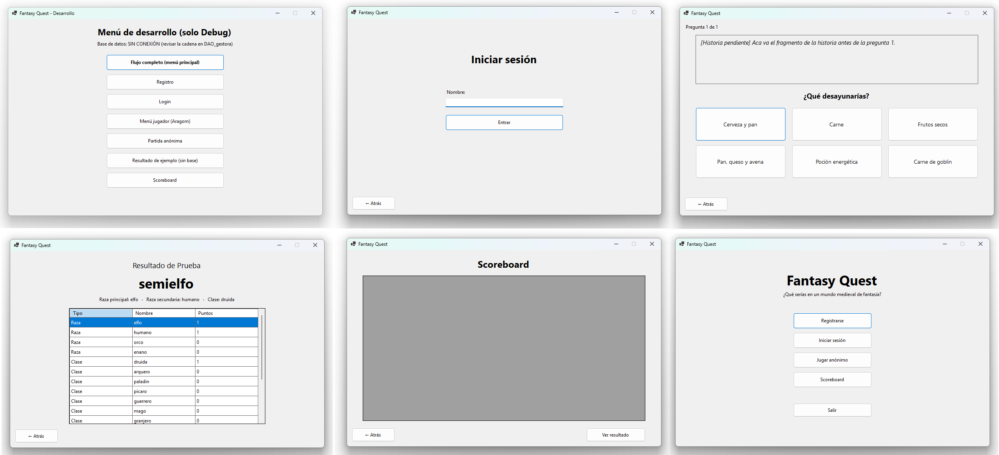
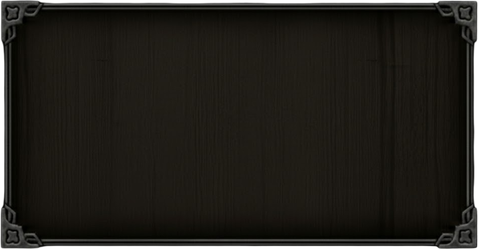
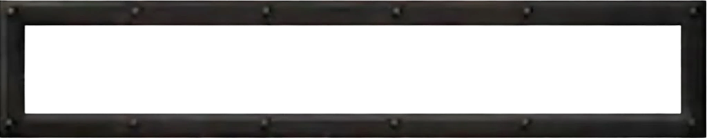

# Proyecto Algoritmos — Fantasy Quest

Juego de preguntas narrativo ambientado en el mundo de **Aeloria**. El jugador toma decisiones a lo largo de 15 preguntas y, según sus respuestas, se le asigna un **perfil** (combinación de raza + clase: enano herrero, elfo mago, orco guerrero, humano asesino, etc.).

---

## Tecnologias

- **C# / Windows Forms** (.NET 9.0)
- **MySQL** como motor de base de datos
- **MySql.Data** (NuGet) para la conexión

### IDE
- Visual Studio 2022 / 2026
- MySQL Workbench

---

## Estructura del repositorio

```
Proyecto-Algoritmos/
├── CShard_algoritmo/           # Solucion y proyecto C#
│   └── Fantasy_quest/
│       ├── Dominio/            # Entidades: Jugador, Perfil, Pregunta, Respuesta, BancoPreguntas, ResultadoPartida
│       ├── Formularios/        # Ventanas WinForms (Ingreso, MenuJugador, Partida, Resultado, Scoreboard, Desarrollo)
│       ├── Gestoras/           # Logica de orquestacion y acceso a datos (GestorPartida, sql_repository)
│       ├── enums/              # Enumerados (razas, clases, modo_juego)
│       ├── ui/                 # Tema visual, imagenes y licencia
│       └── Program.cs
├── Base_de_datos/
│   └── fantasy_quest_bdd.sql   # Script de creacion de la BDD
└── Documentacion/              # Diagramas, historial de UI, narrativa
```

### Capa de algoritmo ↔ base de datos

```
 Formularios  ──►  Gestoras (GestorPartida)  ──►  sql_repository  ──►  MySQL (fantasy_quest)
      │                      │                           │
      │                      ▼                           │
      └────────────► Dominio (Jugador, Perfil,  ◄────────┘
                     Pregunta, Respuesta, etc.)
```

Los formularios no hablan con la base directamente: delegan en las **gestoras**, que trabajan con las clases de **Dominio** y usan `sql_repository` como unica puerta hacia MySQL.

---

## Diagramas

### Diagrama de base de datos (actual)


### Diagrama de base de datos (version anterior)


### Diagrama de clases / algoritmos


---

## Interfaz

### Historial de diseno — V1


### Recursos visuales actuales
Fondo, botones y entrada de texto usados por el tema actual (ver [`CShard_algoritmo/Fantasy_quest/ui/`](CShard_algoritmo/Fantasy_quest/ui)):

| Fondo | Boton | Entrada |
|-------|-------|---------|
|  |  |  |

---

## Documentacion

| Documento | Descripcion |
|-----------|-------------|
| [Alcance del Proyecto](Documentacion/Alcance%20del%20Proyecto%20-%20%C2%BFQu%C3%A9%20ser%C3%ADas%20en%20un%20mundo%20medieval_.html) | Alcance y vision general |
| [Narrativa y preguntas](Documentacion/pregunta.md) | Las 15 preguntas con su contexto narrativo y pesos por raza/clase |
| [Notas de documentacion](Documentacion/notas_documentacion.md) | Notas sueltas de trabajo |
| [Historial de cambios](Historial_de_cambios.md) | Changelog manual del proyecto |
| [Tareas pendientes](tareas_pendientes.md) | TODO list activo |

---

## Base de datos

El script completo esta en [`Base_de_datos/fantasy_quest_bdd.sql`](Base_de_datos/fantasy_quest_bdd.sql). Correrlo contra una instancia MySQL vacia deja la BDD lista para que el proyecto conecte.

---

## Referencias externas

- Estilo UX/UI de referencia: https://www.warcraftcn.com/docs
- Herramienta usada para los diagramas de BDD: https://sqltoerdiagram.com
